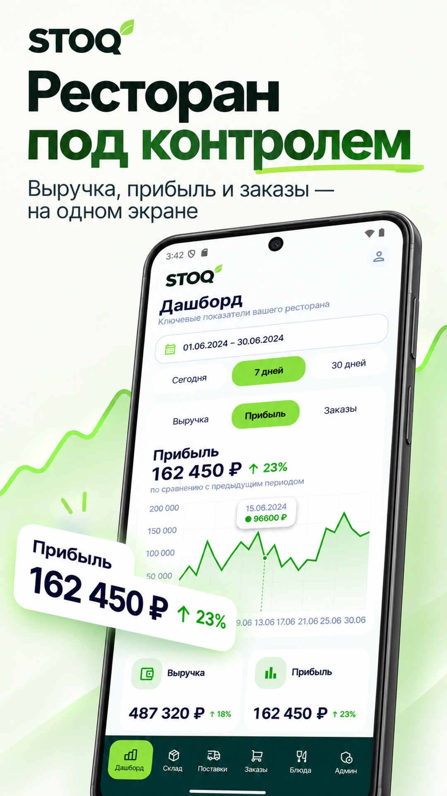
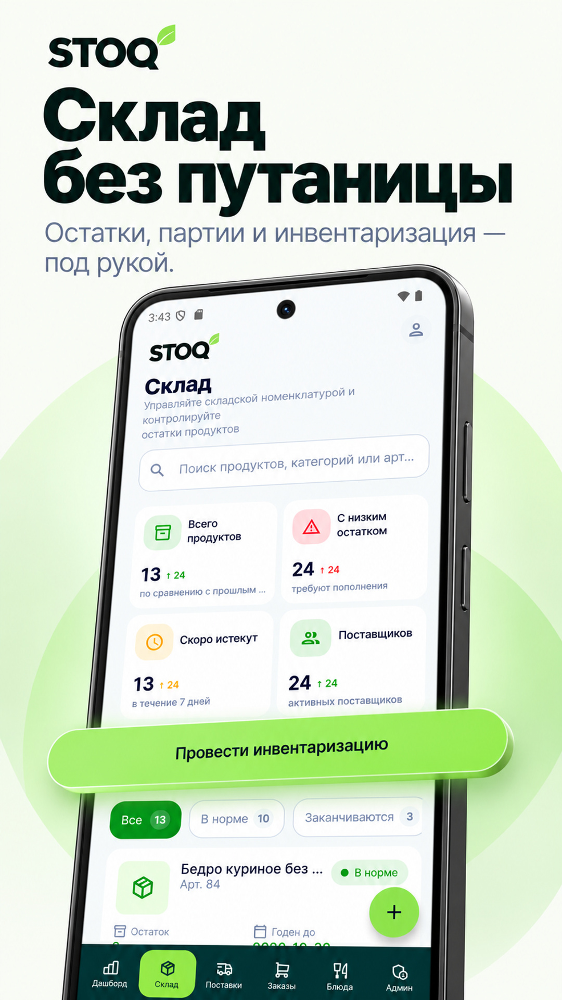
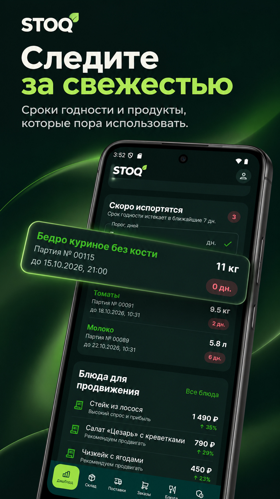
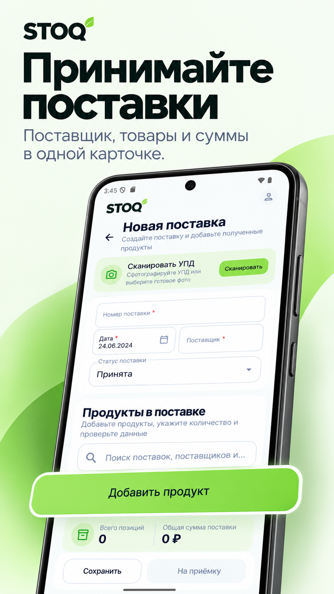
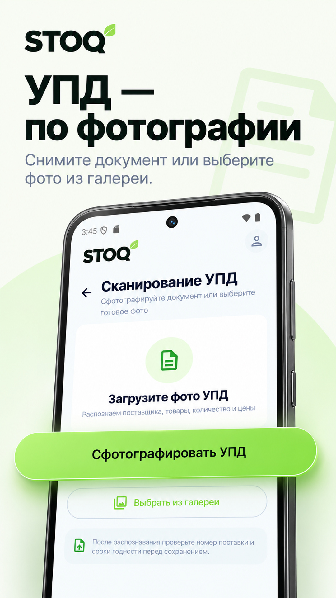
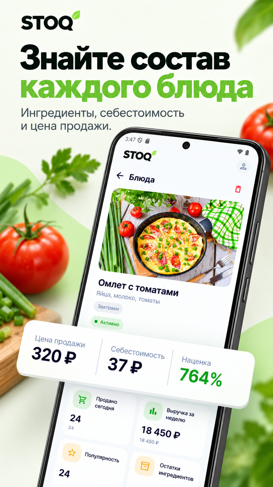
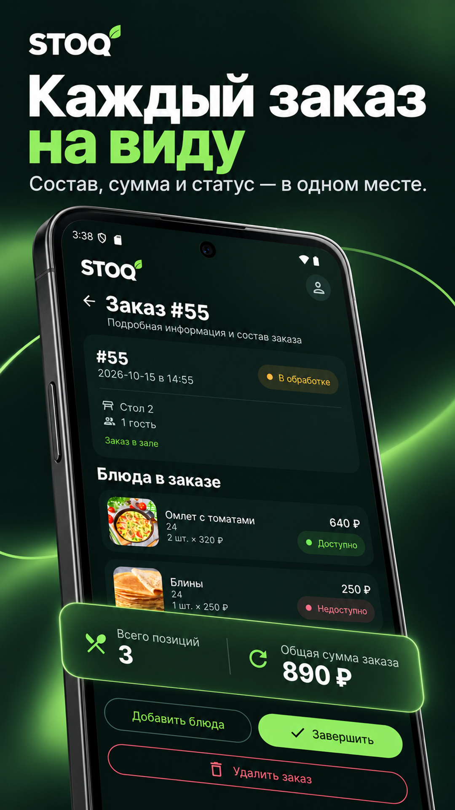
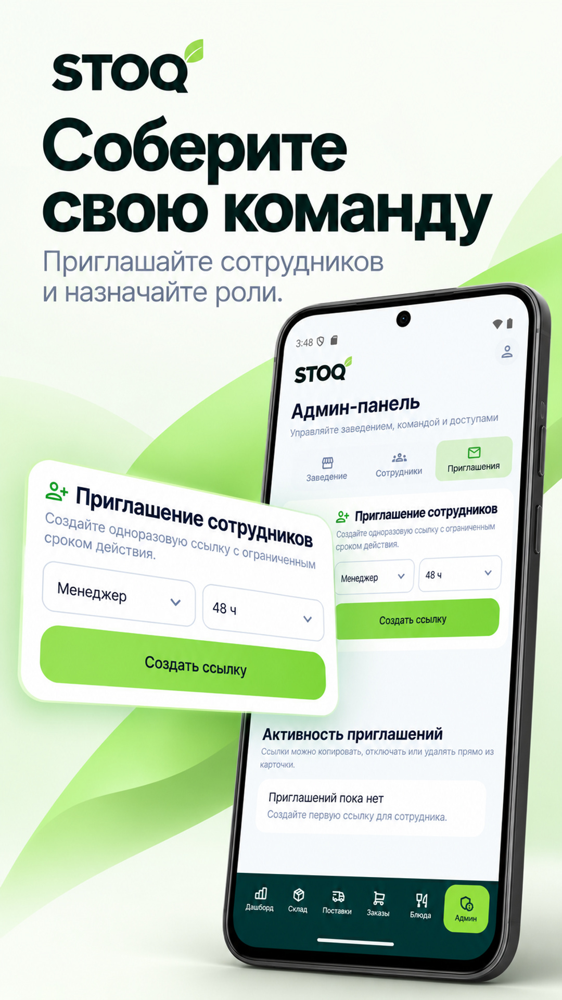

# STOQ

----

## Оглавление

- [Описание](#описание)
- [Структура и особенности кода](#структура-и-особенности-кода)
- [Скриншоты](#скриншоты)
- [Используемые технологии](#используемые-технологии)
- [Установка](#установка)

## Описание

**STOQ** — мобильное Android-приложение для управления рестораном. Оно объединяет складской учёт, поставки, инвентаризацию, меню, заказы и аналитику: помогает контролировать остатки, следить за сроками годности продуктов и координировать работу команды. Интерфейс построен на **Jetpack Compose**, поддерживает светлую и тёмную тему и использует собственную дизайн-систему.

### Основные функции

1. Авторизация, регистрация ресторана и подача заявки на вступление в команду.
2. Разграничение доступа по ролям: **администратор**, **менеджер**, **официант** и **кладовщик**.
3. Дашборд с выручкой, заказами, доступными расчётными показателями и выбором периода.
4. История дефицита продуктов, рекомендации блюд для продвижения и список партий с истекающим сроком годности.
5. Склад с поиском, фильтрацией по статусам, остатками и подробной информацией о продукте из разных поставок.
6. Создание продуктов и единиц измерения, списание доступного остатка партии с подтверждением.
7. Инвентаризация с редактированием фактического количества, проверкой расхождений и сохранением изменений после подтверждения.
8. Просмотр автоматически списанных продуктов и подтверждение их утилизации без повторного списания остатков.
9. Создание и редактирование поставок со статусами **«Принята»**, **«В пути»** и **«Отменена»**, составом, количеством, ценой и датой и временем окончания срока годности продуктов.
10. Распознавание УПД: фотографирование документа или выбор изображения из галереи с подготовкой данных поставки через серверный AI-сервис.
11. Работа с блюдами: создание состава из нескольких продуктов, цена продажи, подробная карточка и динамика продаж с выбором периода.
12. Стоп-лист, рекомендации блюд и обновление складских данных через **WebSocket**.
13. Создание и редактирование заказов, добавление блюд, изменение статуса и просмотр деталей.
14. Локальные черновики **заказов**, **поставок** и **инвентаризаций**, разделённые по аккаунтам.
15. Админ-панель с настройками заведения, подтверждением сотрудников, назначением ролей, блокировкой и управлением одноразовыми приглашениями.
16. Журнал действий сотрудников с группировкой по дням, московским временем, подгрузкой истории и **pull-to-refresh**.
17. Профиль с локальным сохранением данных пользователя, автоматическим обновлением сессии и шифрованием токенов.

## Структура и особенности кода

Проект организован по функциональным пакетам (`auth`, `dashboard`, `products`, `inventory`, `supplies`, `dishes`, `orders`, `admin`, `logs`, `profile`) с разделением на `data`, `domain` и `presentation` там, где эти слои необходимы. Для пользовательских сценариев применяется **MVI-подход**: действия поступают во ViewModel, состояние экрана обновляется и отображается в Compose.

- **Навигация** реализована через `Navigation Compose`: основные разделы доступны из нижней панели, подробные экраны и формы используют отдельные маршруты. Набор разделов определяется ролью сотрудника.
- **Данные пользователя** и локальные настройки сохраняются в `DataStore` с `ProtoBuf`. Кеш профиля доступен без повторного получения данных с сервера.
- **Черновики** хранятся в **Room**. Данные заказов, поставок и инвентаризаций можно сохранить локально и продолжить работу позднее; черновики разных аккаунтов изолированы.
- **DI** построено на **Hilt**: зависимости сетевого слоя, репозитории, хранилища и ViewModel предоставляются через модули внедрения.
- **Дизайн-система** включает собственные цвета, типографику, шрифты, карточки, поля ввода, выпадающие списки и компоненты состояний экранов. Светлая и тёмная темы используют общие компоненты.
- **UI/UX** реализован на **Jetpack Compose**: анимации переходов и раскрытия блоков, индикаторы загрузки, подтверждения опасных действий и обновление списков жестом **pull-to-refresh**.
- **Сетевой слой** использует **Retrofit**, **OkHttp** и **Kotlinx Serialization**. Запросы обрабатываются через общий `safeApiCall`, а загрузка, результат и ошибки отображаются через `UiState`.
- **Обновления в реальном времени** поступают через **Socket.IO**: склад, стоп-лист и рекомендации реагируют на события сервера и показывают уведомления об изменениях.
- **Изображения** загружаются через общий компонент на **Coil** с анимацией загрузки и заглушкой при отсутствии изображения или ошибке.
- **Распознавание УПД** использует системную камеру и выбор файла через `Activity Result API`, `FileProvider` и загрузку изображения на сервер. **ZXing** используется для формирования QR-кода гостевого заказа.
- **Защита сессии** реализована с помощью **AES-256-GCM** и **Android Keystore**. Зашифрованные cookies сохраняются в Proto DataStore, а истёкший access-токен обновляется через refresh-сессию.
- **Конфигурация API** вынесена в локальный `local.properties` через **Secrets Gradle Plugin**. Этот файл не включается в Git.

Пример файла `local.properties`, если захотите скачать и запустить проект:

```properties
sdk.dir=...
BASE_API_URL=https://lyaguh.site/api/
```

## Скриншоты

### Скриншоты для RuStore

<p align="center">
  
  
  
  
  
  
  
  
</p>

Обычные скриншоты приложения находятся в папке [screenshots](screenshots): [светлая тема](screenshots/light) и [тёмная тема](screenshots/dark).

## Используемые технологии

| Технология | Описание |
|------------|----------|
| **Kotlin + Coroutines + Flow** | Логика приложения, асинхронные операции и потоки состояния |
| **Jetpack Compose + Material 3** | Декларативный интерфейс и собственная дизайн-система |
| **Navigation Compose** | Навигация между разделами, формами и подробными экранами |
| **Hilt** | Внедрение зависимостей |
| **Retrofit + OkHttp** | HTTP API, cookies и автоматическое обновление сессии |
| **Kotlinx Serialization** | Сериализация сетевых моделей и локальных данных |
| **Socket.IO** | Обновления склада, стоп-листа и рекомендаций в реальном времени |
| **DataStore (ProtoBuf)** | Пользовательские настройки, кеш профиля и зашифрованная сессия |
| **Room** | Локальная база черновиков с разделением по аккаунтам |
| **Android Keystore + AES-256-GCM** | Хранение ключа шифрования и защита токенов |
| **Coil** | Загрузка изображений, отображение SVG и обработка ошибок |
| **Activity Result API + FileProvider** | Получение фотографий УПД через камеру и выбор изображений |
| **ZXing** | Формирование QR-кода гостевого заказа |
| **Tabler Icons + Material Icons** | Иконки интерфейса |
| **Secrets Gradle Plugin** | Локальная конфигурация API вне Git |
| **JUnit + Compose UI Test** | Проверки логики, сетевых контрактов и интерфейса |

## Установка

<p align="center">Ссылка на текущую версию <a href="https://github.com/MissClickRND/stoq-mobile/releases/tag/v1.0.0">Release v1.0.0</a></p>
<p align="center"><a href="https://github.com/MissClickRND/stoq-mobile/releases/download/v1.0.0/app-release.apk">Прямая ссылка на установку .apk</a></p>
<p align="center">RuStore — приложение находится на модерации. Ссылка появится после публикации.</p>
